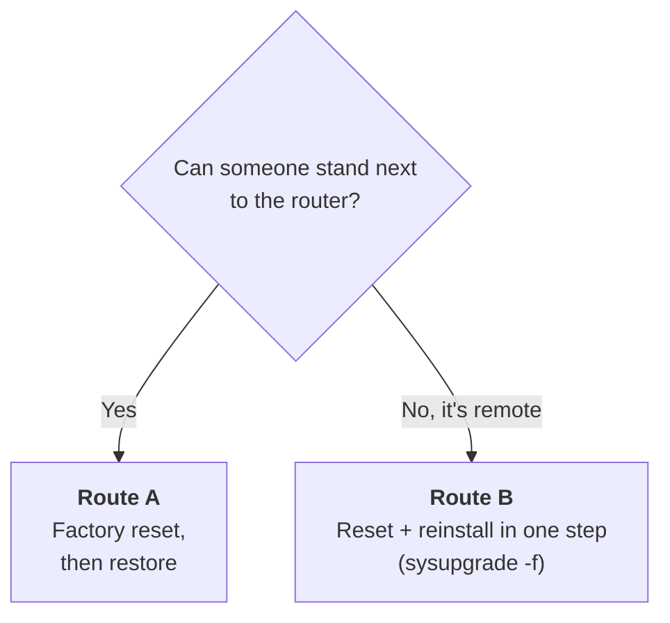

<div align="center">

# 🛟 glbackup

**Config backup & restore for GL.iNet routers**<br>
Flint 3 · Flint 2 · Beryl · Brume · any OpenWrt device

[](LICENSE)


</div>

<br>

GL.iNet's admin panel has **no backup button**, and the backup that does exist lives in LuCI, which you
can't open through GoodCloud.

`glbackup.sh` is one file you copy to the router and run over SSH. No packages, nothing to install,
nothing on your computer.

<br>

## ⚡ Quick start

```sh
scp glbackup.sh root@192.168.8.1:/root/      # copy it over
ssh root@192.168.8.1                         # log in
sh glbackup.sh backup                        # done
```

```text
  ╭──────────────────────────────────────────────────────────╮
  │  GLBACKUP                                                │
  │  Configuration backup for GL.iNet / OpenWrt   v1.0.0     │
  ╰──────────────────────────────────────────────────────────╯

  ✔  Router  GL.iNet BE9300 · flint3 · firmware 4.9.0
  ✔  Reading the backup file list  165 files
  ✔  Creating the archive  <size>
  ✔  Verifying  165 files · gzip OK · key files present
  ✔  Writing checksum  sha256 <first 16 hex digits>…

  What is inside
    ██████████████████   89  Settings (etc/config)
    ██████████░░░░░░░░   50  Other
    ██░░░░░░░░░░░░░░░░   10  System basics (passwd, shadow, rc.local...)
    █░░░░░░░░░░░░░░░░░    9  VPN profiles
    █░░░░░░░░░░░░░░░░░    4  SSH keys (dropbear)
    █░░░░░░░░░░░░░░░░░    2  Tailscale
    █░░░░░░░░░░░░░░░░░    1  AdGuard Home
```

> [!WARNING]
> A backup holds **password hashes and SSH / Wi-Fi keys**. It's saved with mode 600. Keep it private, and
> **copy it off the router**: `/root/backups` lives on internal flash, which a factory reset wipes.

<br>

## 🧰 Commands

| Command | What it does |
|---|---|
| `sh glbackup.sh backup` | Save the router's configuration to a `.tar.gz` *(default)* |
| `sh glbackup.sh restore <archive>` | Put it back, to the right locations *(asks first)* |
| `sh glbackup.sh diff <archive>` | Show what a restore **would** change. Touches nothing |
| `sh glbackup.sh verify <archive>` | Check gzip, checksum, safe paths and key files |
| `sh glbackup.sh show <archive>` | See what is inside |
| `sh glbackup.sh ls` | List saved backups |
| `sh glbackup.sh files` | What a backup would include right now |

<details>
<summary><b>Options</b></summary>

<br>

| Option | |
|---|---|
| `-o DIR` | Backup folder (default `/root/backups`). A USB stick works: `-o /mnt/sda1/glbackup` |
| `-l LABEL` | Add a label to the file name, e.g. `before-upgrade` |
| `--only PATH` | Restore only this file or folder. Repeatable: `--only etc/config/firewall` |
| `--root DIR` | Restore into `DIR` instead of `/`. A safe way to preview |
| `--reboot` | Reboot after a successful restore |
| `--yes` | Don't ask for confirmation |
| `--force` | Allow an archive from a different model or firmware |
| `--no-snapshot` | Skip the automatic pre-restore backup *(not recommended)* |
| `--ascii` | Plain ASCII output (or `GLB_ASCII=1`) |

</details>

<br>

## 📦 What's in a backup

Exactly what LuCI's **System → Backup / Flash Firmware → Generate archive** saves.

The script calls the firmware's own `sysupgrade -l` / `sysupgrade -b`, so it follows the keep-lists of
the firmware you're running, including GL.iNet's (`/lib/upgrade/keep.d/gl-*`): `/etc/config/*`, SSH keys,
password hashes, Tailscale, WireGuard / OpenVPN profiles, AdGuard Home config and more.

The result is a normal `.tar.gz`; LuCI can read it too.

<br>

## 🛡️ How restore protects you

| | Step | What happens |
|:-:|---|---|
| 1 | **Validate** | Refuses unsafe paths (`..`, absolute paths, devices) and files outside `etc/`, `root/`, `lib/wifi/` |
| 2 | **Check** | SHA-256 matches, model and firmware match *(otherwise `--force`)* |
| 3 | **Plan** | Shows identical / replaced / created, and **flags** files that control logins, startup and network access (`rc.local`, `shadow`, `authorized_keys`, `init.d`, `network`, `firewall`) |
| 4 | **Confirm** | You type `RESTORE` |
| 5 | **Snapshot** | Saves the current state first, so you can undo |
| 6 | **Write + verify** | Writes the files, then checks every one against the archive |
| 7 | **Reboot** | Tells you to reboot (or does it with `--reboot`) |

Restore only overwrites and adds files. It **never deletes** anything that isn't in the archive.

<br>

## 🧭 Which route do you need?



| | Route A: reset, then restore | Route B: reset and reinstall |
|---|---|---|
| **Use when** | The router was reset and you want your settings back | The vendor says *"reset and install new firmware"* |
| **Someone on site?** | **Yes** (Reset button, a cable) | **No**, all over SSH or Tailscale |
| **Firmware** | Stays the same | You install a new one |
| **Reboots** | You reboot after restore | The router reboots itself |

<br>

## 🅰️ Route A: after a factory reset

You pressed Reset and you have a backup **saved off the router**.

### 1. Boot and get in

Connect by cable and open the admin panel (`192.168.8.1` on most GL.iNet routers). Set the temporary
admin password the wizard asks for.

> On GL.iNet firmware 4 that password is also the SSH `root` password.

### 2. Copy the script and the backup onto the router

Keep the **three backup files together** and don't rename them. The `.info` and `.sha256` next to the
archive are what enable the checks.

```sh
for f in glbackup.sh glbackup_*; do ssh root@192.168.8.1 "cat > /root/$f" < "$f"; done
```

*(`cat` over SSH works even when the router has no SFTP server. `scp -O` also works.)*

### 3. Check it and preview

On the router:

```sh
sh glbackup.sh verify glbackup_<...>.tar.gz
sh glbackup.sh diff   glbackup_<...>.tar.gz      # after a reset, almost everything shows as "replaced"
```

Read the flagged files.

### 4. Restore

```sh
sh glbackup.sh restore glbackup_<...>.tar.gz
```

Type `RESTORE`. A reset doesn't change the firmware, so the model and firmware check passes if you haven't
upgraded since the backup. If you have, use Route B.

### 5. Know what changes before you reboot

The restore brings back your **real admin password, SSH keys, LAN IP and Wi-Fi settings**.

- Log in with the **old** password, not the temporary one.
- Look for the router at the **old** address, not `192.168.8.1`.
- The restored settings also include the **GoodCloud binding**. To keep the router off the cloud, run this
  *before* rebooting:

  ```sh
  uci set gl-cloud.@cloud[0].enable='0'; uci commit gl-cloud
  ```

### 6. Reboot, once

> [!IMPORTANT]
> Reboot **only after** the script prints `Verifying — every restored file matches the archive`.
> Don't reboot or cut power *during* the restore. It takes seconds.

Use `reboot` (or `restore … --reboot`). Many GL.iNet services only read their settings at boot, so restarting
a few services isn't enough. Wait a couple of minutes, then reconnect at the restored address.

<details>
<summary><b>Can't reach it afterwards?</b></summary>

<br>

Press Reset again and restore in pieces, **network settings last**:

```sh
sh glbackup.sh restore <archive> --only etc/config/system --only etc/config/dhcp
sh glbackup.sh restore <archive> --only etc/config/network
```

</details>

<br>

## 🅱️ Route B: reset and reinstall, remotely

Sometimes the vendor tells everyone to **factory reset and install new firmware**. GL.iNet's security
notice of 2026-11-20 does.

> [!NOTE]
> **Everything below runs on the router, over SSH (or Tailscale).** The router downloads the firmware
> itself, so nothing has to be copied to it and nobody has to be on site.

The firmware has a built-in way to do both at once:

```sh
sysupgrade -f <backup.tar.gz> <firmware.bin>
```

It flashes the new image **and installs your backup as the new system's configuration**, instead of the
old live files.

From reading the firmware scripts (GL.iNet 4.10): the old settings area is rebuilt from the backup rather
than carried over, so this behaves like *reset + restore* with a single reboot. The firmware's own
first-boot path unpacks the backup and runs its migration scripts, which a by-hand restore after booting
skips.


### 1. Back up, and copy it off the router

```sh
sh glbackup.sh backup -l before-upgrade
```

Copy the three files to your computer. The copy on the router is gone if the flash goes wrong.

### 2. Review it

```sh
sh glbackup.sh show <archive>
sh glbackup.sh diff <archive>
```

**For a remote router, make sure the archive contains what brings it back online:**

| Must be in the archive | Why |
|---|---|
| `etc/dropbear/authorized_keys` | your SSH access |
| `etc/config/network` | its addresses |
| `etc/tailscale/` | your VPN, if you use Tailscale |

If the router may be compromised, read the flagged files carefully: **anything in them comes back after
the flash**. If something looks wrong, don't use that archive.

### 3. Get the firmware onto the router, and check it

The `.bin` comes from GL.iNet's download servers (`fw.gl-inet.com`), and the router fetches it itself.

The download page (`https://dl.gl-inet.com/router/<model>`) is a JavaScript app that reads from a public
API. The commands below use that same API.

```sh
MODEL=$(cat /proc/gl-hw-info/model)                  # e.g. be9300
curl -fsS "https://firmware-api.gl-inet.com/cloud-api/model/info?model=$MODEL" -o /tmp/fw.json

# which stable versions exist? (newest first)
jsonfilter -i /tmp/fw.json -e '@.info[@.stage="RELEASE"].version'

# take the newest stable one (use [0] only if that is the version you want)
URL=$(jsonfilter -i /tmp/fw.json -e '@.info[@.stage="RELEASE"].download[0].link'   | head -n1)
SHA=$(jsonfilter -i /tmp/fw.json -e '@.info[@.stage="RELEASE"].download[0].sha256' | head -n1)
echo "$URL"

curl -fL "$URL" -o /tmp/firmware.bin
echo "$SHA  /tmp/firmware.bin" | sha256sum -c -      # must print: /tmp/firmware.bin: OK
```

> [!NOTE]
> That API is **undocumented**. If it stops working, copy the file link and SHA-256 from the download page
> instead.

> [!WARNING]
> The command-line `sysupgrade` does **not** verify GL.iNet's signature (the web UI's upgrade does). The
> hash from the API comes from the same server as the file, so it only catches a *damaged* download.
> To guard against a *tampered* server too, compare the SHA-256 with a second source: the download page in
> your browser, or GL.iNet's release announcement. And make sure it's the version you intend to install.

### 4. Dry run

Checks the image and model. Flashes nothing.

```sh
sysupgrade -T -f /root/backups/glbackup_<...>.tar.gz /tmp/firmware.bin
```

### 5. Flash

```sh
sysupgrade -f /root/backups/glbackup_<...>.tar.gz /tmp/firmware.bin
```

> [!CAUTION]
> Don't add `-n`. That discards the configuration.

Your SSH session closes, the router flashes and **reboots by itself**. Give it a few minutes and don't power
it off.

### 6. Reconnect

Reconnect at the restored address and check it. Optional: disable GoodCloud, as in Route A step 5.

### ⚠️ Weigh these first

- **Wait for the fixed firmware.** Don't reinstall the same vulnerable version "to be safe".
- **There may be no second firmware slot.** The Flint 3 checked here has a single `rootfs` partition. A
  power cut or bad image mid-flash can leave it needing a physical U-Boot recovery. Think twice for sites
  nobody can visit.
- **The image is loaded into RAM** (`/tmp`). If `free` shows less than the image size, reboot first.
- **A different firmware version than the backup's** is outside what GL.iNet supports. This route is the
  same one a normal "keep settings" upgrade takes, but try it on a router you can reach first.
- **Prefer the web UI?** Reset → set up → upgrade in the UI → `glbackup restore --force` (the firmware
  versions differ). That route skips the first-boot migrations, so check the admin panel afterwards.

<br>

## 📝 Good to know

- **A compromised router?** A restore can bring the attacker's changes back. Run `diff` and read the flagged files.
- **Same model and firmware version.** GL.iNet supports restores only that way. `glbackup` enforces it unless `--force`.
- `glbackup` doesn't flash firmware. For that, see Route B, or use GL.iNet's own "keep settings" path.

<br>

## ✅ Tested

| What | Where | |
|---|---|:-:|
| Backup, verify, show, diff, partial and full restore, mismatch refusal, malicious-archive refusal | Sandbox with a stubbed `sysupgrade` (POSIX `dash`) | ✅ |
| `files` command | Real Flint 3 (GL-BE9300, firmware 4.9.0, busybox `ash`), read-only | ✅ |
| Firmware lookup (`curl` + `jsonfilter` against the download API, SHA-256 shown) | Same Flint 3, read-only | ✅ |
| A real backup and restore cycle | Hardware | ⏳ not yet |
| The download and `sysupgrade` steps of Route B, end to end | Hardware | ⏳ not yet |

The two procedures are written from the firmware's own scripts (`sysupgrade`, `platform.sh`, GL.iNet 4.10).
Try restore with `--root /tmp/preview` first.

<br>

---

<div align="center">

[MIT License](LICENSE) · Passes `sh -n` / `dash -n`

</div>
